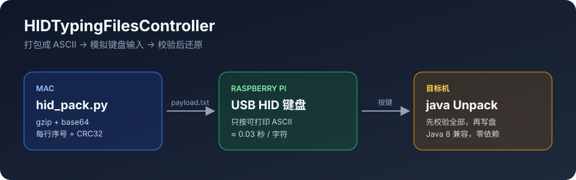

# HIDTypingFilesController



把文件**通过 USB 键盘"敲"进另一台机器**：树莓派模拟 USB HID 键盘，适合目标机只接受键盘输入、
不能联网也不能挂 U 盘的场合。

HID 键盘只能按出可打印 ASCII 和 `\n`、`\r`、`\t`。中文、二进制文件没法直接敲，遇到一个中文字符整次输入就会中断。
所以流程分三步：

```
 Mac                          树莓派                         目标机
 hid_pack.py ──▶ payload.txt ──▶ 模拟键盘逐字输入 ──▶ 记事本里的 .txt ──▶ Unpack ──▶ 原始文件
 (从 git 仓库选文件)  (纯 ASCII, 每行带校验)                          (全部校验通过才写盘)
```

1. **打包**：在 Mac 上把选中的文件压缩、base64 编码，生成一份每行都带序号和 CRC32 的纯 ASCII 文本。
2. **输入**：树莓派把这份文本当键盘敲进目标机的文本编辑器，存成 `.txt`。
3. **解包**：目标机上的 `Unpack`（单个 Java 源文件，兼容 Java 8）先校验每一行和整份数据，确认无误后才还原文件。

## 目录

| 路径 | 用途 | 在哪运行 |
|---|---|---|
| `hid_pack.py` | 打包器：从 git 仓库选文件，生成可输入的 ASCII payload | Mac |
| `Unpack.java` | 解包器：单文件、只用 Java 标准库、兼容 Java 8 | 目标机 |
| `Unpack.txt` | 与 `Unpack.java` 内容相同，方便当普通文本输入 | 目标机 |
| `main.py` | HID 键盘驱动：逐字符发送文件内容（依赖 `tqdm`、`python-dotenv`） | 树莓派 |
| `type.sh` | 用 `sudo` 和项目内 `.venv` 运行 `main.py` 的包装脚本 | 树莓派 |
| `dry.py` | 检查文件里有没有键盘按不出来的字符，不发送 | 树莓派 |
| `requirements.txt` | `main.py` 的依赖 | 树莓派 |
| `pi-standalone/` | 零依赖版本：不需要 venv、不需要网络 | 树莓派 |
| `tests/` | 端到端测试 | Mac |

设计约束：

- **零新增依赖**：打包器只用 Python 标准库，解包器只用 Java 标准库并保持 Java 8 兼容。
- **源仓库只读**：`hid_pack.py` 只读取 git 仓库，从不写回。

## 快速上手

### 1. 打包（Mac）

```bash
cd hid-pack
.venv/bin/python hid_pack.py --repo ../myrepo --from <基线 tag> -n                  # 预览：文件清单、大小、预计输入时长
.venv/bin/python hid_pack.py --repo ../myrepo --from <基线 tag> -o /tmp/myrepo.txt  # 生成 payload
```

`-n` 不写任何文件。先预览，确认清单和时长再生成。

### 2. 输入（树莓派）

先在目标机上打开一个纯文本编辑器（如记事本）并新建空文件，把光标放进去，然后在树莓派上运行：

```bash
./type.sh /tmp/myrepo.txt                 # 逐字符发送，带进度条
./type.sh /tmp/myrepo.txt --batch         # 一次性写入所有按键报文，最快，无进度条
.venv/bin/python dry.py /tmp/myrepo.txt   # 只检查字符，不发送
```

`main.py` 还支持 `--key-press-sleep` / `--key-release-sleep`（默认 0.01 s / 0.02 s）。
树莓派没有网络或没有 venv 时，改用 [`pi-standalone/`](pi-standalone/README.md)，它会等键盘被识别并倒计时后再开始输入。

输入完成后把文件保存好（如 `myrepo.txt`）。`Unpack.java` 也要用同样的方法输入一次，存为 `Unpack.txt`。

### 3. 解包（目标机）

在项目根目录执行：

```bash
cp Unpack.txt Unpack.java
javac Unpack.java                    # 只需编译一次
java Unpack myrepo.txt . --dry-run   # 只校验、列出将要做的事，不写盘
java Unpack myrepo.txt .             # 正式还原
```

`Unpack` 会先检查每行的 CRC32、序号是否连续、整份数据的 SHA-256，**全部通过才开始写文件**；
被覆盖的文件默认备份为 `文件名.bak.yyyyMMddHHmmss`。

## 选择要传的文件

```bash
# 基线 tag 之后的改动，读工作区（含未跟踪文件，跳过 .gitignore 忽略的）
hid_pack.py --repo ../myrepo --from <基线 tag> -o /tmp/myrepo.txt

# 两个 ref 之间的改动，内容从 git 对象读取，工作区里未提交的修改不会混进来
hid_pack.py --repo ../myrepo --from <旧 tag> --to HEAD -o /tmp/myrepo.txt

# 不给 --from：打包 pathspec 下的所有文件
hid_pack.py --repo ../myrepo src ui/src -o /tmp/myrepo.txt

# 只打包纯 ASCII 输入带不过去的文件（含中文或二进制）
hid_pack.py --repo ../myrepo --from <基线 tag> --only-untypeable -o /tmp/myrepo.txt
```

- 命令末尾的 pathspec 可以进一步收窄范围，例如 `':(exclude)tests' ':(exclude)docs'`。
- 以下文件**一律不打包**，并给出警告：
  - 疑似密钥：`.env*`、`*.pem`、`*.key`、`*.jks`、`*.p12`、`credentials.*`、`secrets/`、`id_rsa*` 等；
  - `mock/` 目录下的 `*.sql`：本地开发用的初始化脚本，可能会 `DROP` 共享表。
- 单份 payload 上限 9999 行（序号 4 位），超出会报 `too large`，此时请拆分或收窄范围。

## 大批量交付：拆成多份

```bash
hid_pack.py --repo ../myrepo --from <基线 tag> --split-by module -o /tmp/myrepo-parts
```

按顶层目录拆成一组编号文件（`1-src.txt`、`2-ui.txt`……，根目录下的文件归入 `root`），它们共享同一个 `pack-set` id。
在目标机上把它们都存进同一个文件夹，然后让 `Unpack` 指向**这个文件夹**：

```bash
java Unpack myrepo-parts .
# OK 1 (src) ... / FAILED 2 (ui) ... / MISSING 3 (docs) ...
```

完好的部分照常还原；缺失或输错的部分会被逐个点名（退出码 2），只需重新输入那几份。

## 首次交付：目标机只有基础框架

目标机已经部署了某个基线版本，需要第一次把新项目放上去时：

```bash
hid_pack.py --repo ../myrepo --from <基线 tag> --init -o /tmp/myrepo-init
#   1-sql.txt              新增的 *.sql，最先输入、最先执行
#   2-code.txt             其余新增文件，并附带 hid-notes/framework-changes.txt
#   framework-changes.txt  同一份改动说明（UTF-8），留在 Mac 上查看

# 代码部分太大时，再按模块拆分：
hid_pack.py --repo ../myrepo --from <基线 tag> --init --split-by module -o /tmp/myrepo-parts
```

`--init` **只打包新增文件**。对基线文件的修改和删除不会直接传过去，而是连同 diff 写进 `framework-changes.txt`，
到目标机上手工合并。目标机上的顺序：

```bash
java Unpack 1-sql.txt . --dry-run
java Unpack 1-sql.txt .
#   按说明里的顺序执行解出来的 SQL
java Unpack 2-code.txt .
#   最后对照 hid-notes/framework-changes.txt 手工合并基线文件
```

## Unpack 参数

```
java Unpack <payload 文件或文件夹> [输出目录] [--dry-run] [--no-backup] [--apply-deletes]
```

| 参数 | 作用 |
|---|---|
| `--dry-run` | 只校验并列出操作，不写盘 |
| `--no-backup` | 覆盖文件时不生成 `.bak` 备份 |
| `--apply-deletes` | 执行删除（默认只列出待删除的文件） |

退出码：`0` 成功，`1` 参数或 IO 错误，`2` payload 校验失败。

记事本保存为 UTF-8、带 BOM 的 UTF-8 或 "Unicode"（UTF-16 LE/BE）都可以；CRLF 换行、行首缩进、空行都不影响解析。

## payload 格式（v1）

```
-----BEGIN HID PAYLOAD-----
version: 1                                   <- 头部是 "key: value"，还有 source/created/from/to/mode/
...                                             files/deletes/raw-bytes/gz-bytes/lines/sha256
pack-id / pack-count / pack-label / ...      <- 仅分段包才有
0001<256 个 base64 字符><8 位 CRC32>          <- 数据行：序号 + 数据 + 本行校验
...
-----END HID PAYLOAD-----
```

- 所有数据行拼起来是一个 gzip 流的 base64；解压后以 `HIDP\x01` 开头，
  每个条目为 `[类型:1][路径长度:4][UTF-8 路径]([内容长度:4][内容])`，类型 1 = 文件、2 = 可执行文件、3 = 删除、0 = 结束。
- 出错时的提示：某行输错 → 报该行序号（checksum mismatch）；漏行 → `seq NNNN is missing`；末尾被截断 → `no END marker`。
- 拒绝绝对路径、含 `..`、反斜杠或 `:` 的路径。
- 头部字段只增不改：不带 `pack-*` 的旧 payload 依然能解。

## 注意事项

- **关闭 Caps Lock。** base64 区分大小写，大写锁定会让每一行都校验失败。
- **输入速度约 0.03 秒/字符**（`main.py` 默认值），1 万字符约 5 分钟。压缩后的 payload 比直接输入源文件更短，
  所以纯 ASCII 文件也建议打包。长 payload 输入前一定先 `-n` 预览。
- **`Unpack.java` 本身也要输入一次**：约 13.9k 字符、7 分钟左右。源码保持纯 ASCII、不含 tab
  （终端里 tab 会触发补全）。请输入到纯文本编辑器或 heredoc 里，不要用会自动补全括号的 IDE。
- **中文文件名**在 Linux 目标机上需要 UTF-8 文件名编码（如 `LC_ALL=C.UTF-8`），不满足时 `Unpack` 会提示。
- **固定主键的种子 SQL 不能重复执行**，目标库已有相同 id 时会冲突，执行前先确认。
- 交付包含基线文件改动时，`framework-changes.txt` 是这些改动的唯一载体，务必合并。
- payload 属于项目数据，不要提交进本仓库。

## 测试

```bash
.venv/bin/python -m unittest discover -s tests -v
```

需要 `git` 和 JDK；测试会用 `javac --release 8` 编译 `Unpack.java`，确保只用到 Java 8 的 API。
覆盖打包到解包的完整流程、错行/漏行/截断、路径穿越、BOM 与 UTF-16、分段包、`--init` 等场景。
